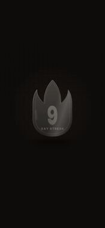
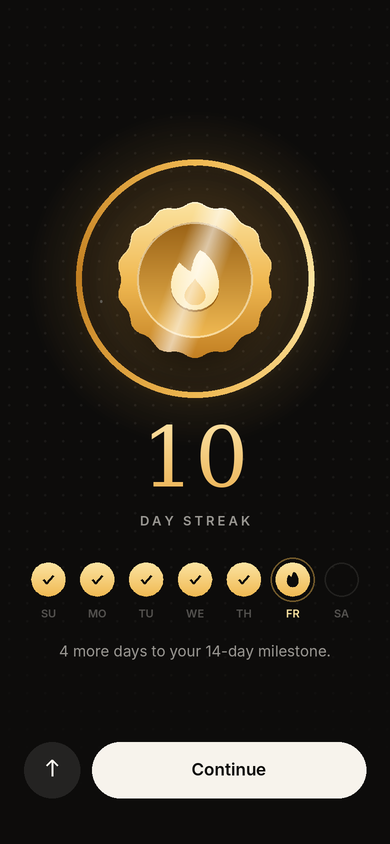

# StreakCelebration

A SwiftUI screen for the moment a user extends their streak, laid out like a trophy screen: a hexagonal
fire badge in chrome and glossy enamel, then the date, the title "10 Day Streak" and a short description,
over a charcoal stage that warms into gold towards the bottom, with a single share button.

The badge rises from below the screen at twice its size, turning as it comes, and lands at its place
facing you as the gold at the bottom of the screen warms up. It shows its chrome edge and the same artwork
on its back, in its own colours from start to finish. Then it shrinks back to its own size, and the words
and the share button arrive. After that it turns a full circle every few seconds, like a trophy on a
turntable.

<p align="center">
  
  &nbsp;&nbsp;
  
</p>

> The previews above were rendered from this package's `CelebrationTimeline`, `TokenProjection`,
> `TokenLight` and `BadgeOutline` values (the same numbers the SwiftUI views read). Both faces are the real
> badge artwork; the edge, the light and the fonts are close approximations of what SwiftUI draws. For the
> real thing, open the package in Xcode and use the canvas preview.

## Run it in the Simulator

You need a Mac with Xcode 16 or newer. Clone once:

```sh
cd ~ && git clone https://github.com/nodedesignagency/streak.git
```

Then, whenever there are changes:

```sh
cd ~/streak && git fetch origin && git checkout claude/great-maxwell-9wf1fn && git pull && ./scripts/run.sh
```

`scripts/run.sh` builds `Demo/StreakDemo.xcodeproj`, boots an iPhone simulator, installs the app and launches
it. The celebration plays on launch; change the streak and tap **Celebrate** to see it again. Pass a
simulator name to pick one, for example `./scripts/run.sh "iPhone 16 Pro"`. You can also open
`Demo/StreakDemo.xcodeproj` in Xcode and press ⌘R.

## Use it

Add the package (File ▸ Add Package Dependencies… ▸ Add Local… or this repo's URL), then present the screen:

```swift
import StreakCelebration

.fullScreenCover(isPresented: $showStreak) {
    StreakCelebrationView(streak: 10) {
        showStreak = false
    }
}
```

| Parameter | Default | |
| --- | --- | --- |
| `streak` | required | The streak after today's activity. |
| `today` | `.now` | The day being celebrated, shown above the title. |
| `message` | days to the next milestone | The paragraph under the title. |
| `onClose` | no-op | Called from the close button. |

Requires iOS 17 / macOS 14 and Xcode 16 or newer.

To tune it, open `Package.swift` in Xcode, open `StreakCelebrationView.swift` and use the canvas. In the
preview, tapping the close button replays the animation.

## Choreography

All timing lives in `Motion/CelebrationTimeline.swift`. Every layer is a pure function of elapsed time
(`Track(…).to(…, at:, over:, curve)`), so the sequence can be replayed, skipped, scrubbed and unit-tested.

| Time | Beat |
| --- | --- |
| 0.00s | **Rise** (light haptic): the badge starts 1,000 pt below its place, off the bottom of the screen, at twice its size and turned 37° with its chrome edge on the right. It rises fast, slowing as it nears its place, and turns as it comes, its right side towards you. The gold wash at the bottom of the screen is dim. |
| 0.52s | Edge-on, low on the screen; its back, the same artwork as the front, comes round. |
| 0.85s | Its back faces you as it nears its place. It is turning fastest here (about 355°/s). |
| 1.13s | Edge-on again, the front coming round; the turn eases off. |
| 1.80s | **Lands** (success haptic, heavy on a milestone day): it comes to rest at its place facing you, still twice its size, and the gold wash warms up. |
| 2.00s | It shrinks back to its own size over half a second. |
| 2.55s | The date, title and description rise in. |
| 3.15s | The share button arrives. |
| 6.00s | It turns a full circle at half the speed it rose with, and again every six seconds after that. Between turns it holds perfectly still. |

Each turn is an ease-in-out (`Curve.easeInOutQuad`) that starts and ends at rest and peaks at twice its
average speed half-way round: 1.8 seconds as it rises, twice as fast as the 3.6-second turns once it has
settled. Rising and turning end together, so it lands just as it faces you. The idle turn's direction,
length and curve were measured frame by frame from the trophy-screen recording. A hot spot and a sheen
slide across the badge as it turns towards and away from the light, and the chrome edge glints as it
catches it (`Motion/TokenLight.swift`).

Both faces of the badge are the artwork itself (`Resources/Badge.xcassets`), shown in its own colours.
What turns with it is drawn in SwiftUI: the chrome edge, and a hot spot and sheen that slide across the
face. They share one outline, a rounded hexagon fitted to the artwork (`Motion/BadgeOutline.swift`),
which also cuts the artwork out. The badge is drawn as a projected solid rather than with stacked 3D layers:
the visible face is squashed by the cosine of its angle and shifted by its thickness, and the edge is the
outline stretched sideways (`Motion/TokenProjection.swift`). That keeps the depth order right at every angle.

To use different artwork, keep it the same shape: 624 × 684 px (208 × 228 pt at @3x), transparent
outside the outline. If its proportions or corner radius differ, update `HeroMetrics` and
`BadgeOutline.cornerRadius` to match.

Other details:

- **Tap anywhere** to skip to the settled state.
- **Reduce Motion** shows the settled state straight away, face-on, without the turns.
- **VoiceOver** reads the date, title and description together, then the share and close buttons; the
  badge itself is decorative because the title says the same thing.
- The screen always plays on its own dark stage and sets `.preferredColorScheme(.dark)` so the status bar
  stays readable. Colours, including the badge's chrome, are in `Views/StreakPalette.swift`.
- The description counts down to the next milestone (3, 7, 14, 21, 30, 50, 75, 100, 150, 200, 250, 300,
  365, then every 100 days) and calls it out on the day it's reached.

## Layout

```
Sources/StreakCelebration/
  StreakCelebrationView.swift   Screen, stage choreography, haptics, previews
  Motion/                       Pure Foundation: timeline, easing, projection, lighting, badge outline
  Model/                        Pure Foundation: milestones, copy
  Views/                        Badge, its outline shape, button style, palette
  Resources/                    Badge artwork (asset catalog)
Tests/StreakCelebrationTests/   Swift Testing suites for Motion and Model
Demo/                           Demo app (StreakDemo.xcodeproj, generated from project.yml by XcodeGen)
scripts/run.sh                  Build the demo and launch it in the Simulator
```

Run the tests with `swift test`. `Motion` and `Model` don't import SwiftUI, so the suite also runs on Linux.

## References

The screen follows the third and fourth reference recordings (a "Workout of the Day" trophy screen):
a trophy that turns on its own, then a small date, a title and a short description over a charcoal stage
that warms into gold at the bottom, a dark share pill on the gold and a rounded close button. The badge
and the title-and-description pairing under it come from the "Fire Streak" badge reference: a hexagon
with raised chrome outlines and glossy red, orange and yellow enamel, a flame in the centre with an inner
yellow flame and a white four-point sparkle, and rays out to the left and right. Once settled, the badge
turns the way the coin in the trophy-screen recording does: the direction of the turn, its length and its
ease-in-out were measured from it frame by frame. The thick edge comes from the second recording.
